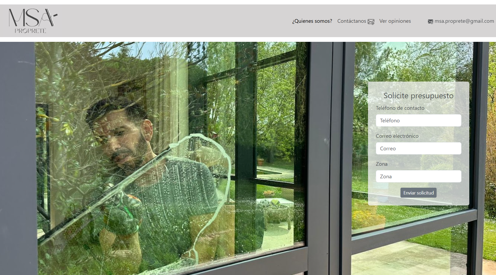
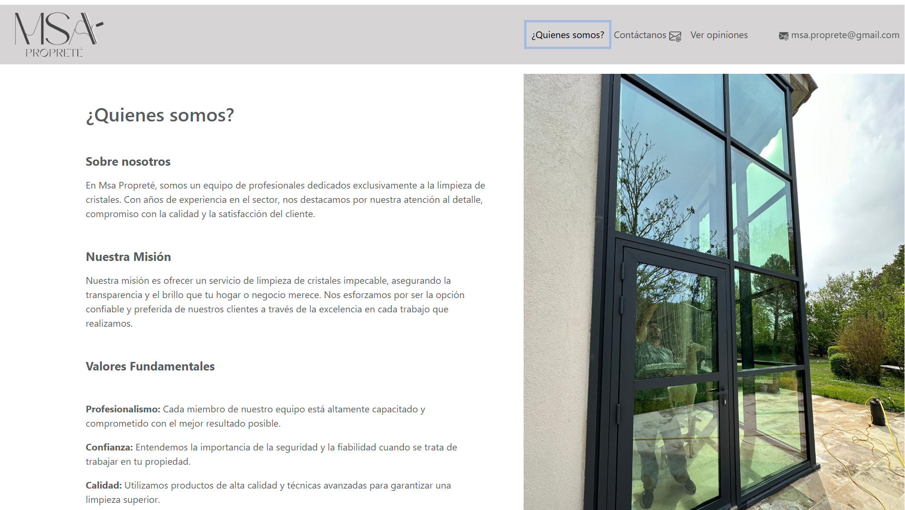
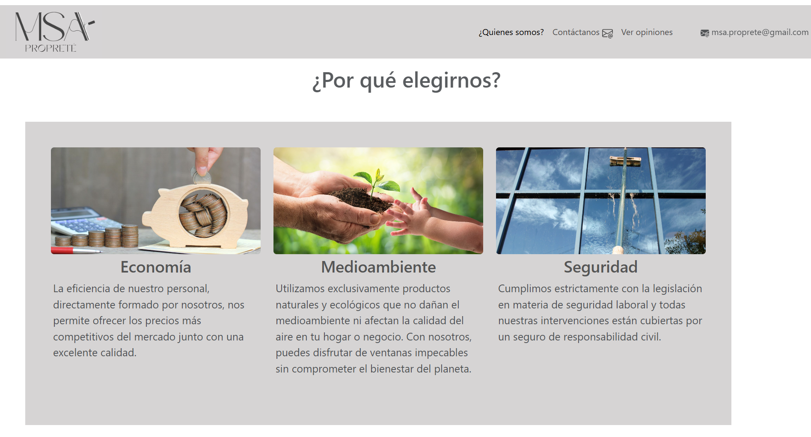
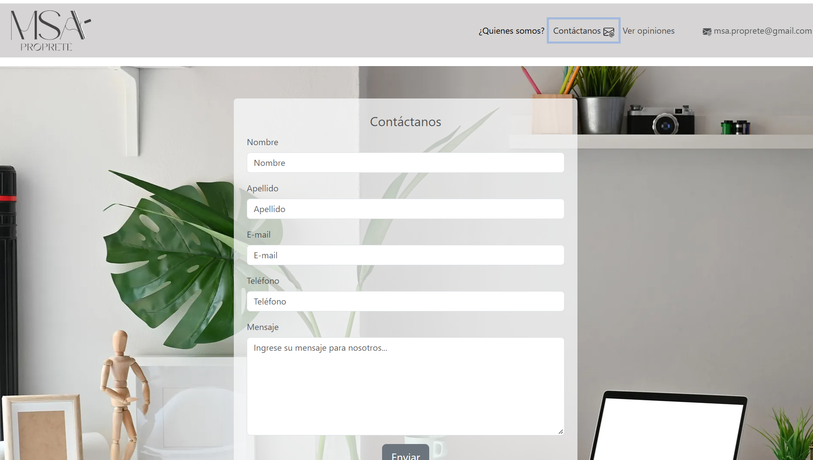

# React Business Website

A responsive business website developed with React as a frontend development project.

## About the Project

This project consists of a multi-page website designed to present a business, its services, and contact information through a clean and user-friendly interface.

## Technologies Used

- React
- JavaScript
- HTML5
- CSS3
- Bootstrap
- React Router
- EmailJS

## Main Features

- Multi-page navigation.
- Responsive design.
- Reusable React components.
- Contact section.
- Email integration.

## Screenshots

### Home Page


### About Us


### Description


### Why Choose Us


### Contact


## Installation and Setup

To run this project locally:

1. Clone the repository:

   ```bash
   git clone YOUR_REPOSITORY_URL
   ```

2. Navigate to the project directory:

   ```bash
   cd YOUR_PROJECT_FOLDER
   ```

3. Install dependencies:

   ```bash
   npm install
   ```

4. Start the development server:

   ```bash
   npm start
   ```

The application will run at http://localhost:3000.

## Author

Marcelo Armas

Frontend Development | React | JavaScript

